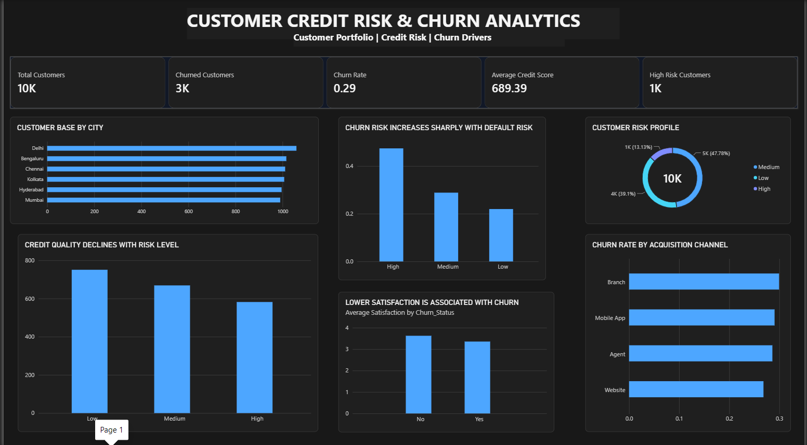
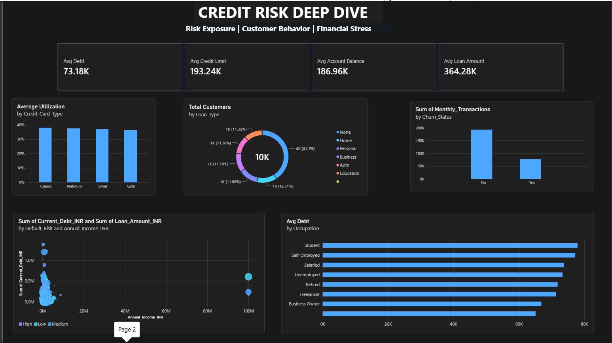

# Customer Credit Risk & Churn Analytics Dashboard

A two-page Power BI dashboard for a portfolio of 10,000 bank customers. It looks at two linked problems: **which customers are risky to lend to**, and **which customers are likely to leave**, and checks how the two overlap.

---

## What I wanted to find out

- How many customers churn, and who are they?
- How is the customer base split across risk levels, and how does credit quality change with risk?
- Does default risk, satisfaction or acquisition channel have any link to churn?
- What does financial stress look like across card types, loan types and occupations?

---

## Dashboard pages

### 1. Customer Credit Risk & Churn Analytics

The portfolio view: headline KPIs, customer split by city and risk, and the main churn drivers.



**Headline numbers**

| Metric | Value |
|---|---|
| Total customers | 10K |
| Churned customers | 3K |
| Churn rate | 0.29 (about 29%) |
| Average credit score | 689.39 |
| High risk customers | 1K |

**What stands out**

- **Churn rises sharply with default risk.** The churn rate is about 0.47 for high risk customers, around 0.29 for medium and about 0.22 for low. High risk customers leave at roughly twice the rate of low risk ones
- **Credit quality falls as risk goes up.** Average credit score is about 750 for low risk, 670 for medium and 580 for high risk, so the risk labels line up with credit scores
- **Most customers are medium or low risk.** Medium is about 48% of the base, low about 39% and high about 13%
- **Unhappy customers churn more.** Average satisfaction is a little lower for churned customers than for those who stayed (roughly 3.4 against 3.65)
- **Customers are spread evenly across cities.** Delhi, Bengaluru, Chennai, Kolkata, Hyderabad and Mumbai each have about 1,000 customers
- **Acquisition channel makes only a small difference.** Branch has the highest churn rate (about 0.30) and Website the lowest (about 0.27)

### 2. Credit Risk Deep Dive

A closer look at exposure, behaviour and financial stress.



**Averages across the portfolio**

| Metric | Value |
|---|---|
| Avg debt | 73.18K |
| Avg credit limit | 193.24K |
| Avg account balance | 186.96K |
| Avg loan amount | 364.28K |

**What stands out**

- **Credit card utilization is almost the same for every card type.** Classic, Platinum, Silver and Gold all sit at roughly 37 to 38%, so card tier doesn't change how much customers borrow
- **About 41% of customers have no loan.** The rest are split fairly evenly across Home, Personal, Business, Auto and Education loans (about 11 to 12% each)
- **Average debt is highest for students and self-employed customers** (around 77 to 78K) and lowest for business owners (around 67K). The gap between occupations is fairly narrow
- **Churned customers have lower total monthly transactions** than retained ones, though this chart shows totals, so part of the gap is simply that there are fewer churned customers
- **The debt vs income scatter plot has extreme outliers.** A handful of customers have annual incomes near 100M INR, far above everyone else, and these should be checked and treated before drawing conclusions about income

---

## Key takeaways

1. **Default risk is the strongest churn signal** in this dashboard. Retention efforts could focus on high risk customers, although these are also the customers the bank may be least willing to keep.
2. **Satisfaction matters, but not by a huge margin.** Churned customers rate their experience lower, so improving service quality is worth tracking.
3. **Channel and city are not major drivers.** Churn is fairly even across both, so changes there are unlikely to move the overall rate much.
4. **The data needs a check for outliers** in income before using it for deeper modelling.

---

## Features

- KPI cards on both pages
- Bar, donut, scatter and horizontal bar charts
- Insight-style chart titles (for example "Churn risk increases sharply with default risk") so each visual tells its story
- Dark theme designed for readability

---

## Repository structure

```
credit-risk-churn-dashboard/
├── images/
│   ├── credit-risk-churn-overview.png
│   └── credit-risk-deep-dive.png
└── README.md
```

Add your `.pbix` file (and the dataset, if you are sharing it) to the root of the repo and list it here.

---

## How to use it

1. Clone or download this repository
   ```bash
   git clone https://github.com/<your-username>/<your-repo-name>.git
   ```
2. Open the `.pbix` file in [Power BI Desktop](https://powerbi.microsoft.com/desktop/)
3. Move between the two pages using the page tabs at the bottom

---

## Tools used

- **Power BI Desktop** for the data model, DAX measures and visuals

---

## What I'd do next

- Build a churn prediction model using the risk, satisfaction and transaction data
- Add average (not just total) transactions per customer to compare churned and retained customers fairly
- Clean the extreme income values and re-run the debt vs income analysis
- Add filters for city, occupation and card type

---

## About me

Created by **Surya Bhola** as part of my data analyst portfolio.

- LinkedIn: [linkedin.com/in/suryabhola-da](https://www.linkedin.com/in/suryabhola-da)
- Email: [isuryabhola@gmail.com](mailto:isuryabhola@gmail.com)

Feedback and suggestions are always welcome.
